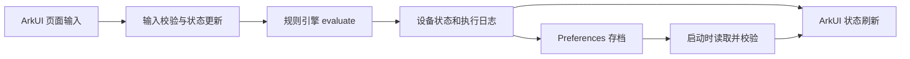

# 架构与测试说明

## 数据流

`Index.ets` 接收设备、环境、规则和场景操作；`RuleEngine.ets` 对启用规则按优先级降序及 ID 升序排序，基于本轮环境计算命中。对同一设备仅执行最高顺位动作，其他命中规则生成冲突日志。`StateStore.ets` 将完整状态以 JSON 写入 Preferences；`StateCodec.ets` 在恢复时验证结构和业务边界。

## 核心接口

| 接口 | 输入 | 输出 | 边界/异常 |
| --- | --- | --- | --- |
| `validEnvironment` | 温度、湿度、光照 | 是否在指定范围 | 拒绝 NaN、无穷值与越界 |
| `validRule` | 规则、设备目录 | 规则是否可执行 | 检查名称、优先级、字段、比较符、阈值及设备 ID |
| `matches` | 单条件、环境 | 条件真假 | `<` 与 `<=` 等阈值语义分明 |
| `evaluate` | 应用状态、时间 | 新设备状态及日志 | 环境或启用规则无效时抛错；冲突动作写明跳过 |
| `decodeState` | 存档 JSON | 校验后的状态 | 格式损坏、缺设备、重复规则 ID 等抛错 |
| `StateStore.save/load` | 应用状态或空 | Preferences 存取 | 调用方捕获读写异常并显示反馈 |

## 测试映射

| 用例 | 类型 | 验证重点 |
| --- | --- | --- |
| `normal_hot_and_dry_changes_two_devices` | 正常 | 一轮同时更新两个设备 |
| `normal_two_conditions_must_both_match` | 正常 | 双条件必须同时成立 |
| `boundary_equality_is_inclusive_only_for_greater_equal` | 边界 | 比较符在阈值处的行为 |
| `conflict_higher_priority_wins_and_logs_skipped_action` | 正常/冲突 | 高优先级胜出且有日志 |
| `conflict_equal_priority_uses_rule_id` | 边界/冲突 | 同优先级排序稳定 |
| `boundary_environment_limits_are_valid` | 边界 | 合法端点值 |
| `exception_out_of_range_environment_is_rejected` | 异常 | 越界环境拒绝执行 |
| `exception_invalid_rule_is_rejected` | 异常 | 无效规则拒绝 |
| `recovery_valid_state_round_trip_and_corruption_fails` | 正常/异常 | 状态编码与损坏存档 |

本地单元测试仅覆盖纯业务逻辑和存档结构。Preferences 真实写盘、ArkUI 操作、应用进程重启后的恢复须通过模拟器或真机测试并留证。
